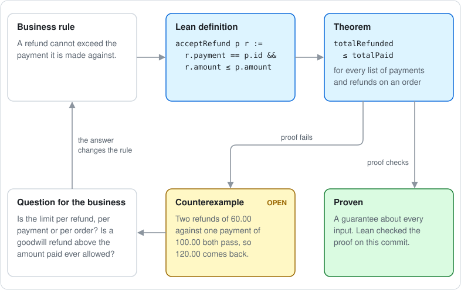
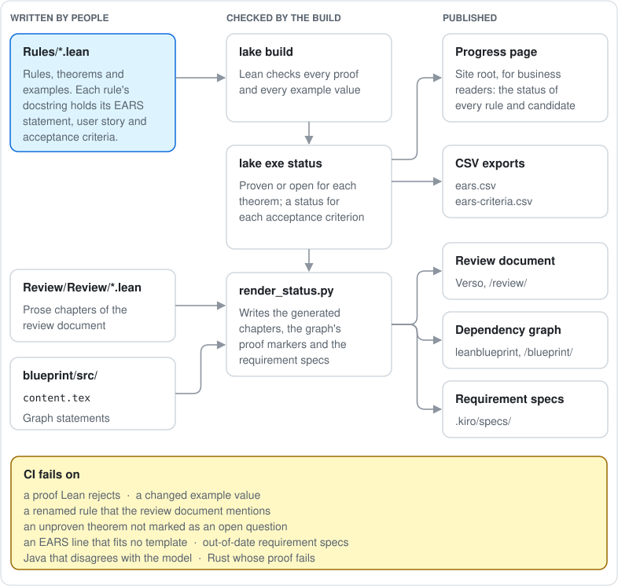
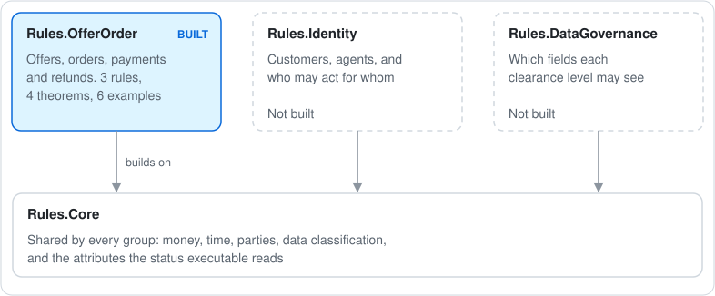
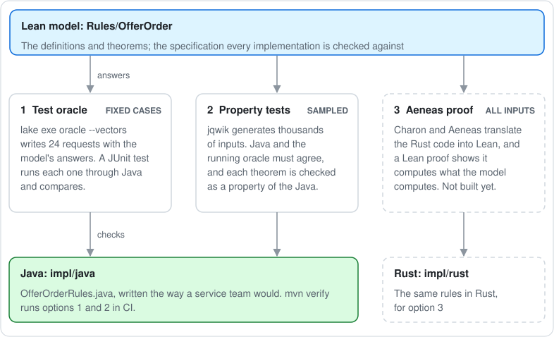

# business-rules-verified

Business rules for airline offers and orders, written as code that a computer
checks, with the review documents and requirement specs generated from that
code on every commit. It covers one slice of the Offer and Order domain: an
offer with priced items and an expiry, the order created when a customer
accepts it, payments against the order, and refunds against payments.

This is a proof of concept built from public material only. The objects
follow IATA's public Offers and Orders standard,
[ONE Order](https://www.iata.org/en/programs/airline-distribution/retailing/one-order/).
The rules, prices and data are simplified and invented.

- Review document: <https://samdengler.github.io/business-rules-verified/>
- Requirement specs for Kiro: [`.kiro/specs/`](.kiro/specs/)
- Dependency graph: <https://samdengler.github.io/business-rules-verified/blueprint/dep_graph_document.html>

## Where to start

| You want to | Read |
| --- | --- |
| Understand the rules and the open question, without reading code | The [review document](https://samdengler.github.io/business-rules-verified/), chapters Overview, Rules and Open Questions |
| Use the requirements in a spec-driven flow | [`.kiro/specs/README.md`](.kiro/specs/README.md), then one `requirements.md` per area |
| See which rules rest on which definitions, and what is proven | The [dependency graph](https://samdengler.github.io/business-rules-verified/blueprint/dep_graph_document.html) (green is proven or defined; no fill is open) |
| Check a service's code against the model | [Checking an implementation against the model](#checking-an-implementation-against-the-model), then [`impl/java`](impl/java/) and [`impl/rust`](impl/rust/) |
| Review or change the model | [`Rules/OfferOrder/`](Rules/OfferOrder/), then the rest of this README |

## Lean, proofs, and the refund example

[Lean](https://lean-lang.org) is a functional programming language and a proof
assistant. People use it to write ordinary programs, to formalize mathematics,
and to prove that software behaves as specified, all in the same language. In
this repository a business rule is an ordinary Lean
function, and a property the rule should have is a theorem: a claim about every
possible input. A test checks the inputs someone thought of; a proof covers all
of them. When the build succeeds, Lean has checked every proof. Checking
programs and rules this way is called formal verification.

The refund rule shows how this works. The rule as the business states it is
"a refund cannot exceed the payment it is made against". In Lean it is a
function that answers true or false for one payment and one refund:

```lean
def acceptRefund (p : Payment) (r : Refund) : Bool :=
  r.payment == p.id && decide (r.amount.amount ≤ p.amount.amount)
```

The property we expect is that refunds on an order never add up to more than
was paid for it (two hypotheses are left out here):

```lean
theorem refunds_le_payments ... :
    totalRefunded ps rs orderId ≤ totalPaid ps orderId := by
  sorry
```

`sorry` marks a proof that is missing. This one cannot be written, because the
claim is false for the rule as stated: two refunds of 60.00 USD against one
payment of 100.00 USD each pass the check and together return 120.00 USD. The
model holds that case as a computed example, and the build marks the theorem
**open**. The open theorem is a question for the business: does the limit apply
to each refund, to all refunds on a payment, or to all refunds on an order?
Once the business answers, the rule changes and the proof can be completed.
That was tried on a scratch branch: with a rule that counts earlier refunds,
the theorem was proven.



What a proof here does and does not cover: it is a statement about the Lean
model. It says nothing yet about whether a production service follows the
model. Comparing services against the model with generated tests is a later
step.

## How the build turns the model into documents

People write the Lean files, the prose chapters and the blueprint statements.
Everything else is computed, so no status or example value is typed by hand.



If someone renames a rule, the review document fails to build. If an example's
value changes, `lake build` fails. If a theorem is left unproven without being
marked as an open question, `lake exe status` fails. CI runs all of these on
every push.

The model is split by business group. Shared concepts such as money and time
live in `Rules/Core/`, and each group gets its own directory under `Rules/`.
Offer and Order is the first group; the others in the diagram are not built.



## Checking an implementation against the model

The proofs above are about the Lean model. A service that a team ships is
separate code, so it needs its own check against the model. There are three
ways to do that, from quick and partial to slow and complete. Options 1 and 2
are built here for a Java implementation of the three rules,
[`impl/java`](impl/java/). Option 3 needs Rust, because Aeneas translates
Rust, and is built for a Rust implementation of two of the rules,
[`impl/rust`](impl/rust/). All three run in CI on every push.



| Option | What it checks | What a pass means |
| --- | --- | --- |
| 1. Test oracle | `lake exe oracle --vectors` writes 24 requests with the model's answers: the inputs of the examples, the boundaries around expiry and the refund limit, and every delivery state and event. [`ConformanceVectorsTest`](impl/java/src/test/java/offerorder/ConformanceVectorsTest.java) runs each one through the Java code. | Java is right on those 24 cases. |
| 2. Property tests | [jqwik](https://jqwik.net) generates thousands of inputs. [`ModelAgreementProperties`](impl/java/src/test/java/offerorder/ModelAgreementProperties.java) sends each one to the running oracle and to the Java code and compares the answers. [`GuaranteeProperties`](impl/java/src/test/java/offerorder/GuaranteeProperties.java) restates each Lean theorem as a property of the Java code, tagged with its acceptance criterion. | Java is right on every input tried. This is strong evidence, but it is not a proof. |
| 3. Aeneas proof | [Charon and Aeneas](https://github.com/AeneasVerif/aeneas) translate the Rust implementation into Lean, and [`Verify/RustRules.lean`](Verify/RustRules.lean) proves it computes what the model's definition computes. | The Rust code is right on every input. |

### The test oracle and the conformance vectors

The oracle is the model itself, run by Lean's interpreter behind a JSON
interface: one request per line in, one answer per line out (see
[`Oracle/Handle.lean`](Oracle/Handle.lean)). The property tests keep it
running and ask it about each generated input.

The conformance vectors are the oracle's answers to a fixed list of requests,
saved as a file:
<https://samdengler.github.io/business-rules-verified/conformance-vectors.jsonl>.
Each line is one case: a name, a request to one of the rules, and the model's
answer. For example, shortened:

```json
{"name": "accept at expiry",
 "request":  {"rule": "accept", "now": 1793102400, "orderId": "ORD-2",
              "offer": {"id": "OFF-1", "expiresAt": 1793102400, "currency": "USD", "items": [...]}},
 "response": {"error": "expired"}}
```

The 24 cases are the inputs of the six `@[case]` examples in the model; the
boundaries around them (one second before, at and after expiry; a refund
below, equal to and one cent above the payment, and one against a different
payment); and every delivery state paired with every event. The answers come
from the model, so nobody types an expected value, and a change to a rule
changes them on the next build.

The file needs nothing but a JSON reader. A team in any language can download
it and run each case through its own code, without installing Lean. The
property tests are more thorough, because they try new inputs on every run,
but they need the oracle running and so need the Lean build.

### What the checks catch

Changing the Java expiry check from `now >= expiresAt`
to `now > expiresAt` fails all three Java test classes: the vector "accept at
expiry", the agreement property (which shrinks to an empty offer accepted
exactly at expiry), and the `accept_rejects_expired` property. The open
question shows up too. The property for `refunds_le_payments` is marked as
expected to fail, and jqwik finds the counterexample on its own, shrunk to one
payment and two refunds against it that together exceed it. If the refund rule
is fixed, that property starts passing and the test fails until the
expectation is removed, just as the Lean theorem's `sorry` would be.

### Running the Java checks

The oracle needs the Lean build first:

```sh
lake build Oracle oracle
mkdir -p build/oracle && lake exe oracle --vectors > build/oracle/vectors.jsonl
mvn -f impl/java/pom.xml verify
```

### The Aeneas proofs for the Rust code

[`impl/rust/src/lib.rs`](impl/rust/src/lib.rs) implements `step` (OO-002) and
`accept_refund` (OO-003) in ordinary Rust. Charon reads the Rust compiler's
view of that file and Aeneas turns it into Lean:
[`Verify/Rust/OfferOrderRules.lean`](Verify/Rust/OfferOrderRules.lean), one
Lean function per Rust function. The translation models Rust exactly: a `u64`
can hold at most 2^64 - 1, and every function returns a result that would
record a panic or an overflow if one could happen.

[`Verify/RustRules.lean`](Verify/RustRules.lean) maps the Rust types to the
model's types and proves two theorems:

- `step_matches_model`: for every delivery state and event, the Rust `step`
  returns without failing and gives the model's answer.
- `accept_refund_matches_model`: for every payment and refund, the Rust
  `accept_refund` returns without failing and gives the model's answer.

The mappings are one-to-one, so no two Rust values stand for the same model
value. References are numbers in the Rust code and strings in the model, so
the refund theorem holds for any way of naming the numbers as strings, as long
as different numbers get different names.

The proofs catch real mistakes. Letting the Rust `step` cancel a delivered
service, or writing `<` instead of `<=` in the refund limit, makes the
corresponding proof fail once the Rust is translated again.

What is not covered: `accept` builds order references by joining strings, and
Aeneas does not handle Rust strings well, so it has no Rust version here. A
proof also says nothing about code outside the translated functions, such as
how a service reads its input or stores its result.

`Verify/Rust/` is generated and committed. CI translates the Rust again with
the pinned Aeneas release and fails if the result differs from the committed
file, so a change to the Rust code has to be translated and proved again
before it can be merged.

### Running the Rust checks

```sh
cargo test --manifest-path impl/rust/Cargo.toml
scripts/translate-rust.sh     # Charon and Aeneas: impl/rust to Verify/Rust/
lake build Verify             # the proofs
```

`scripts/translate-rust.sh` downloads the pinned Aeneas release, which
includes Charon, into `.aeneas/`, and installs the nightly Rust toolchain
Charon needs with rustup.

## How this repository was made

[Claude Code](https://claude.com/claude-code), Anthropic's coding agent, built
this repository from a written implementation plan. The plan had six steps:
the Lean project and shared concepts, the Offer and Order rules, the checked
examples, the review documents, the EARS output, and CI. It also had ten
acceptance criteria. Claude Code committed after each step; the
[commit history](https://github.com/samdengler/business-rules-verified/commits/main)
shows them in order. The Kiro specs and the implementation checks were
added afterwards on request. Where
the plan left a choice open, the choice is recorded under
[Decisions](#decisions). [Results](#results) gives the check of each
acceptance criterion.

The domain comes from IATA's Offers and Orders standard,
[ONE Order](https://www.iata.org/en/programs/airline-distribution/retailing/one-order/).
The objects in the model (offer, offer item, order, order item, and the
delivery status of a service) follow the standard's concepts, and the
docstrings name the ONE Order concept each corresponds to. The rules, prices
and data are simplified and invented for this proof of concept; they are not
transcribed from the standard. Writing the standard itself as a Lean namespace,
and proving where an airline's own rules match or differ from it, is a planned
next step.

The rules, user stories and acceptance criteria are drafts. The Offer and
Order team has not reviewed them yet.

## The two review layers

| Layer | Source | Published at |
| --- | --- | --- |
| Verso document: prose with checked Lean inside it | `Review/` | site root |
| leanblueprint: dependency graph colored by status, plus a PDF | `blueprint/src/content.tex` | `/blueprint/` and `/blueprint/print.pdf` |

The requirements are also published as Kiro specs, one folder per Lean module
that holds rules, in [`.kiro/specs/`](.kiro/specs/). Opening this repository in
Kiro shows them as specs. Each `requirements.md` has the module's
introduction, and for each rule its user story, its EARS statement, and its
acceptance criteria in Kiro's `WHEN ... THE SYSTEM SHALL ...` notation. Each
criterion carries its ID and the status the build computed for it.
[`.kiro/specs/README.md`](.kiro/specs/README.md) indexes them with every
criterion's status.

The same requirements are also exported as CSV, for tools that import rows
rather than read Markdown: a spreadsheet, a requirements tracker such as Jira,
a dashboard, or a script.

| File | One row per | Columns |
| --- | --- | --- |
| [`ears.csv`](https://samdengler.github.io/business-rules-verified/ears.csv) | rule | ID, EARS statement, Lean declaration, status, theorems that prove it |
| [`ears-criteria.csv`](https://samdengler.github.io/business-rules-verified/ears-criteria.csv) | acceptance criterion | ID, parent rule, EARS statement, EARS template, status, theorems and examples that check it |

Both are rebuilt on every push at fixed URLs, and their IDs never renumber, so
a tool can pull them on a schedule. Because each row carries a computed status,
comparing two versions shows which criteria changed, for example OO-003.2
moving from open to proven once the refund question is answered.

Both layers are built from the same commit and take their status from the same
file, `build/status.json`, which `lake exe status` computes from the compiled
Lean.

## Authored and computed parts

Authored, and reviewed against the Lean by a second person:

- Docstrings in `Rules/` (they are the prose of both layers, written in Verso
  markup). A rule's docstring holds its `EARS:` statement, a `Story:` line, and
  its acceptance criteria as list items (`* OO-001.1: If ...`).
- The `@[checks "OO-001.1"]` tags on theorems and examples, which say which
  criteria each one checks.
- The Verso chapters `Overview`, `Objects`, `Rules` and `Open Questions` in
  `Review/Review/`.
- The blueprint statements in `blueprint/src/content.tex` (without `\leanok`).
- The Java implementation and its tests in `impl/java/`, and the oracle's JSON
  interface and vector inputs in `Oracle/Handle.lean`.
- The Rust implementation in `impl/rust/`, and the proofs about it in
  `Verify/RustRules.lean`.

Computed by the build, never typed:

- Whether each theorem is proven or open: `lake exe status` checks the axioms
  each theorem depends on for `sorryAx`.
- Example values: each `@[case]` declaration is evaluated by `lake exe status`,
  and each `#guard` in `Rules/OfferOrder/Examples.lean` fails the build if a
  value changes.
- The EARS table (`build/ears.md`, `build/ears.csv`), from the `EARS:` line of
  each rule's docstring and its `@[ears "OO-00n"]` ID.
- Each acceptance criterion's status, from the theorems and examples that
  check it: open if a checking theorem is open, proven if one is proven,
  example only if only examples check it, and not checked otherwise. The
  criteria go to `build/ears-criteria.csv` and into the Kiro specs.
- The Kiro specs in `.kiro/specs/`. These are committed so they can be read on
  GitHub and opened in Kiro, and CI fails if the committed copies differ from
  what `scripts/render_status.py` writes.
- The Lean translation of the Rust code in `Verify/Rust/`, generated by Charon
  and Aeneas and committed; CI fails if it differs from a fresh translation.
- The conformance vectors' expected answers (`build/oracle/vectors.jsonl`),
  from the model through `lake exe oracle --vectors`.
- `\leanok` markers in the blueprint, and the Verso `Guarantees`, `Examples`
  and EARS sections, written by `scripts/render_status.py` into
  `blueprint/src/*.generated.tex` and `Review/Review/Generated/`.

`lake exe status` exits nonzero if any declaration depends on `sorry` without
the `@[open_question]` tag, if an EARS statement or acceptance criterion does
not follow exactly one EARS template, if a rule lacks a story or criteria, or if
a `@[checks]` tag names a criterion no rule defines. CI runs it before
rendering anything.

## Building locally

Prerequisites: [elan](https://github.com/leanprover/elan), Python 3.12,
graphviz, a TeX installation with `xelatex` and `latexmk` (TinyTeX works),
Java 21 with Maven, and rustup for the implementation checks.

```sh
lake exe cache get                      # prebuilt Mathlib, once
lake build                              # the Rules library
lake exe status                         # build/status.json, ears.md, ears.csv, ears-criteria.csv
python3 scripts/render_status.py        # .kiro/specs and the generated review sections
python3 scripts/diagrams.py             # the README diagrams in docs/diagrams/
lake build Oracle oracle                # the test oracle for implementation checks
lake build Verify                       # the proofs about the Rust implementation

python3 -m venv .venv && . .venv/bin/activate
pip install leanblueprint               # on macOS with Homebrew graphviz, set
                                        # CFLAGS=-I$(brew --prefix graphviz)/include
                                        # LDFLAGS=-L$(brew --prefix graphviz)/lib
scripts/build-site.sh                   # everything CI builds, assembled in site/
python3 -m http.server -d site          # preview at http://localhost:8000
```

`scripts/build-site.sh` runs, in order: `lake build`, `lake exe status`,
`scripts/render_status.py`, `lake build Review`, `lake exe review-doc`,
`leanblueprint web`, `leanblueprint checkdecls`, `leanblueprint pdf`.

## Versions

| Tool | Version |
| --- | --- |
| Lean | `leanprover/lean4:v4.35.0` |
| Mathlib | tag `v4.35.0` |
| Verso | tag `v4.35.0` |
| Aeneas | release `nightly-2026.10.26-da2b22e` (binary, bundled Charon, and Lean library) |
| Rust | stable for `cargo test`; `nightly-2026-09-17` for Charon |
| checkdecls | `master` at `3d42585` |
| leanblueprint | 0.0.20 |
| Java | 21 (Temurin) |
| Maven | 3.9 |
| JUnit | 5.11.4 |
| jqwik | 1.9.2 |

`lake-manifest.json` pins every Lean dependency to a commit, and
`impl/java/pom.xml` pins the Java ones.

## Results

Checked on 2026-10-24 against the plan's acceptance criteria. CI run:
[40113345785](https://github.com/samdengler/business-rules-verified/actions/runs/40113345785).

| # | Criterion | Result |
| --- | --- | --- |
| 1 | `lake build` from a clean clone after `lake exe cache get`, under 10 minutes | Pass. Clean clone: `lake exe cache get` 65 s, `lake build` 15 s. In CI the lean-action step (cache plus build) takes about 3 minutes. |
| 2 | `lake exe status` writes `status.json` and `ears.md`, three proven, one open, exit 0 | Pass. `Rules.OfferOrder`: 3 proven, 1 open (`refunds_le_payments`). It also writes `ears.csv`. |
| 3 | Rejecting a second refund against a payment lets `refunds_le_payments` be proven | Pass, on a discarded branch. `acceptRefund` took the list of refunds already accepted and rejected a second refund against the same payment. The theorem's hypothesis then says each refund was accepted given the ones before it. The proof closed without `sorry`, and `lake exe status` reported 4 proven, 0 open, exit 0. |
| 4 | Changing a `#guard` expected value by one unit fails `lake build` | Pass. `24500` to `24501` failed `Rules.OfferOrder.Examples`; reverted. |
| 5 | `checkdecls` passes; graph shows the open theorem uncolored and the rest green | Pass. All 24 defined or proven nodes are green; `refunds_le_payments` has no fill (see Decisions). |
| 6 | Verso document builds; renaming `accept` to `acceptOffer` fails it | Pass. The rename failed at `Review/Review/Rules.lean:21` ("Unknown identifier `Rules.OfferOrder.accept`"). `render_status.py` also refused, because `content.tex` names `accept`. Reverted. |
| 7 | Examples chapter shows six cases whose values match the `#guard`s | Pass. Six cases; values come from `lake exe status`. |
| 8 | `build/ears.csv` has three rows, OO-001 to OO-003 | Pass. |
| 9 | CI green on `main`; Pages serves the Verso document at the root and the blueprint at `/blueprint/` with a working PDF link | Pass, after making the repository public (see Decisions). |
| 10 | README covers the two layers, authored and computed parts, the local build, and Decisions | Pass. |

**Pages URLs.**

- Verso document: <https://samdengler.github.io/business-rules-verified/>
- Blueprint: <https://samdengler.github.io/business-rules-verified/blueprint/>
- Dependency graph: <https://samdengler.github.io/business-rules-verified/blueprint/dep_graph_document.html>
- PDF: <https://samdengler.github.io/business-rules-verified/blueprint/print.pdf>
- EARS table, one row per rule: <https://samdengler.github.io/business-rules-verified/ears.csv>
- Acceptance criteria, one row per criterion: <https://samdengler.github.io/business-rules-verified/ears-criteria.csv>
- Kiro specs, rendered on GitHub: <https://github.com/samdengler/business-rules-verified/tree/main/.kiro/specs>
  (the same files are on Pages under `/specs/`)
- Conformance vectors for implementation checks: <https://samdengler.github.io/business-rules-verified/conformance-vectors.jsonl>

## Decisions

Choices made where the plan left room, in the order they came up.

1. **Lean version.** Mathlib master pinned `v4.36.0-rc1`, and Verso has a tag
   with the same name, so Mathlib, Verso and the toolchain all used
   `v4.36.0-rc1`. Mathlib and Verso are pinned by tag in `lakefile.toml`. Their
   shared dependencies (plausible, Cli) resolve to the same commits. The
   repository later moved to the `v4.35.0` release; see decision 27.
2. **Cache download.** `lake new ... math` runs `lake exe cache get` itself.
   That first run downloaded the Mathlib cache; the `lake update` and
   `lake exe cache get` in Step 1 then had nothing left to fetch.
3. **Linter.** The template's `weak.linter.mathlibStandardSet` is removed; it
   enforces Mathlib's copyright header and style rules, which do not apply
   here. `autoImplicit = false` is set as the plan asks.
4. **`public` is a keyword** in this Lean version, so the first
   `Classification` constructor is written `«public»`.
5. **`Instant` ordering.** `LinearOrder` cannot be derived, so it is lifted
   from `epochSeconds` with `LinearOrder.lift'`.
6. **Amounts in minor units.** The plan's refund example uses 60, 100 and 120.
   The model stores minor units, so the case uses 6000, 10000 and 12000 cents
   (60.00, 100.00 and 120.00 USD).
7. **`accept` also rejects mixed currencies**, since `Rejection` has a
   `mixedCurrency` constructor. The checks run in the order expiry, empty offer,
   currency.
8. **Distinct payment IDs.** `refunds_le_payments` assumes the payment IDs are
   distinct. Without that, the statement fails even after the refund rule is
   fixed, for a reason unrelated to the business question. The double-refund
   counterexample uses one payment, so it still applies.
9. **What the status executable lists.** Only documented declarations are
   listed, so derived instances, structure projections and helper lemmas
   without docstrings are left out. Proven and open counts are reported per
   namespace. The acceptance count (three proven, one open) refers to
   `Rules.OfferOrder`; `Rules.Core` adds two proven lemmas (`public_le`,
   `Money.add_same_currency`).
10. **Example values** are computed with `Lean.Meta.evalExpr` inside the status
    executable (built with `supportInterpreter = true`). The `#eval` fallback
    was not needed. The executable imports only `Rules.Core.Attributes` and
    loads `Rules` from its `.olean` files at run time. Importing all of `Rules`
    made linking compile Mathlib's native code, which took 14 minutes in CI.
11. **Docstrings use Verso markup** (`doc.verso = true` for the whole
    package). Code spans carry roles: `{name}` for model declarations (a rename
    breaks the docstring), and `{lit}` or `{lean}` for literals and terms.
    `Status/Main.lean` turns the option off, since its comments are for
    developers.
12. **Generated Verso modules.** The plan names one `Generated.lean`. Each Verso
    chapter is its own module, so the script writes three:
    `Review/Review/Generated/Guarantees.lean`, `Examples.lean` and `Ears.lean`.
    They are gitignored and regenerated on every build, as are
    `blueprint/src/*.generated.tex`.
13. **Verso layout.** The `Review` library has `srcDir = "Review"`, so its
    chapters sit in `Review/Review/`. The `review-doc` executable's root is
    `Review/Main.lean`. Verso writes `build/review/html-multi/`, and that
    directory becomes the site root.
14. **Statement in the Guarantees chapter.** Each guarantee shows its Lean
    statement twice: in the `{docstring}` box, which renders the full signature,
    and in a checked ```` ```lean ```` block (`#check @name`).
15. **`leanblueprint new` answers:** checkdecls yes; doc-gen4 no (the Verso
    document takes the place of API docs); Jekyll home page no; CI yes. The
    generated `blueprint.yml` and the template's other three workflows were
    then folded into `ci.yml`.
16. **Graph colors.** Proven theorems get `\leanok` on both the statement and
    the proof, so they fill dark green. The open theorem gets neither. By
    default leanblueprint would fill it light blue ("ready to prove");
    `\graphcolor{can_prove}{}{No}` in `macros/web.tex` leaves it unfilled. Its
    blue border still says the statement is ready.
17. **Blueprint to Verso links.** leanblueprint links each `\lean{}` name to
    `{dochome}/find/#doc/<name>`. `\dochome{../docs}` points that link at
    `pages/docs/find/index.html`, a small redirect into Verso's own
    `find/?name=<name>` page, which jumps to the declaration's section.
18. **CI step order.** `render_status.py` runs before the Verso build, because
    it writes chapters the build imports. `leanblueprint web` runs before
    `checkdecls`, because `web` writes the `lean_decls` file that `checkdecls`
    reads.
19. **TeX in CI.** CI installs TinyTeX instead of `texlive-full`, matching the
    local setup, which also uses TinyTeX. It is far smaller, and its default
    package set built the PDF with no additions. CI runs `tlmgr update --self`
    first, because the installer's `tlmgr` refused to install packages until
    it was updated. CI's TinyTeX has fewer packages than the local one, so CI
    installs every package the local PDF build loads, read from `print.fls`. CI also caches the compiled Verso packages, keyed on
    `lake-manifest.json`.
20. **Pages deploys from `main` only.** Pull requests build and upload the
    site but do not deploy it.
21. **The repository is public.** The plan asked for a private repository.
    GitHub refused Pages for it on this account's plan ("Your current plan does
    not support GitHub Pages for this repository"), so the repository was made
    public with Sam's approval, and Pages was enabled with GitHub Actions as
    the source. The deploy job still checks the repository variable
    `PAGES_ENABLED` (set to `true`), so a fork or a copy without Pages keeps a
    green build.
22. **EARS outputs.** The status executable writes `build/ears.csv` along with
    `ears.md`. "Proven by" lists every theorem whose statement mentions the
    rule, so OO-001 lists both `accept` theorems.
23. **Branch protection** is not turned on for the POC. CODEOWNERS names
    `@samdengler` on every path.
24. **Acceptance demos.** The demos (fixing the refund rule, changing a
    `#guard`, renaming `accept`) were run locally on a branch or as uncommitted
    edits, then discarded, as the plan says.
25. **Kiro specs and acceptance criteria** (added after the plan, at Sam's
    request). The Kiro specs are Markdown so they can be used with Kiro's
    spec-driven flow; `ears.csv` stays as an extra export. Decisions:
    - One spec folder per Lean module that holds rules, named from the
      namespace and the module's title, for example
      `offer-order-accepting-an-offer`. The module docstring becomes the
      introduction.
    - Criterion IDs extend the rule's ID (`OO-001.1`) and are written by hand
      in the docstring, like the rule IDs, so they never renumber.
    - The EARS text stays in standard form in the docstrings ("When X, the
      system shall Y"). The Kiro files print it in Kiro's notation
      (`WHEN X THE SYSTEM SHALL Y`, `IF X THEN THE SYSTEM SHALL Y`).
    - A criterion's status is computed from what checks it, but whether a
      theorem's statement covers the criterion's wording is a review question:
      the `@[checks]` tag is authored.
    - An example that checks an open criterion is labelled a counterexample.
    - Four criteria (OO-002.2, OO-002.3, OO-002.5, OO-003.1) have no theorem or
      example yet and are shown as not checked. Adding theorems for them would
      change the proven count the acceptance criteria fix at three.
    - Only `requirements.md` is generated; `design.md` and `tasks.md` belong to
      the team using the spec.
26. **Implementation checks** (added after the plan, at Sam's request). The
    target teams use Java, so options 1 and 2 are shown on a Java
    implementation; option 3 needs Rust because Aeneas translates Rust.
    - The oracle runs the model in Lean's interpreter, loading `Oracle.Handle`
      from its `.olean` files like `lake exe status` does. Compiling the rules
      into the executable would link Mathlib's native code.
    - The JSON shapes are the ones Lean derives for the model's types, so the
      oracle adds no mapping of its own. The Java tests do the mapping.
    - Lean's amounts are natural numbers; Java uses `long`. The generators
      produce only non-negative amounts below 50,000, so the two agree on every
      generated input.
    - Inputs are generated close together (instants around expiry, three
      shared payment IDs) so that boundaries and repeated refunds come up
      often.
    - The open theorem's property uses jqwik's `@ExpectFailure`, the Java
      counterpart of `@[open_question]`.
27. **Aeneas and the move to Lean `v4.35.0`.** The proofs about the Rust
    code need the model and Aeneas's Lean library in one build, and that
    library is pinned to Lean and Mathlib `v4.35.0`. The repository moved from
    `v4.36.0-rc1` to the `v4.35.0` release, which Verso also tags. The status
    counts, the review document and the conformance vectors came out the same.
    - The Aeneas binary and its Lean library are pinned to the same release,
      `nightly-2026.10.26-da2b22e`. Aeneas publishes nightly releases only.
    - The Rust code uses numbers for references, because Aeneas handles
      integers and not strings. The refund theorem therefore takes any
      one-to-one naming of numbers as strings.
    - `accept` has no Rust version, because it joins strings to make order
      references.
    - The generated Lean in `Verify/Rust/` is committed, like the Kiro specs,
      and CI checks that it matches a fresh translation.
