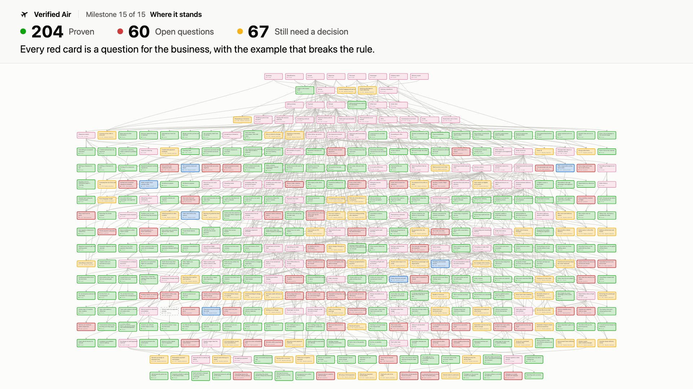

# Motion piece: how the graph grew

[](https://samdengler.github.io/verified-air/graph/?view=history)

1. The pilot (0:00)
2. First survey (0:08)
3. Starting small (0:14)
4. Foundations (0:18)
5. Second survey (0:24)
6. Each area in Lean (0:33)
7. An independent review (1:00)
8. The fixes (1:07)
9. Where it stands (1:15)

*The film: the pilot, two surveys of IATA's public pages, each area written in Lean, an independent review of the model and its fixes, and where the model stands. Click the last frame to play the film on the site, one step at a time.*

A film of the dependency graph growing over the milestones in [`history/`](../history/), made with [Remotion](https://www.remotion.dev): a React composition that is rendered frame by frame in headless Chrome and encoded to MP4. It follows the storyboard in [`docs/motion-brief.md`](../docs/motion-brief.md). The History tab of the site's [Explore page](https://samdengler.github.io/verified-air/graph/?view=history) shows it above the milestone player and plays it one step at a time.

## Steps

`STEPS` at the top of `src/story.ts` holds each step's start and title, one to a line. The History tab plays a step and pauses `REST_SECONDS` (0.3 s) before the next one starts, with buttons for the previous and next step, replaying a step and playing to the end, and a seek bar in place of the browser's controls. A check at the end of `src/story.ts` stops the bundle unless every step ends on a still frame: for half a second before the pause no card appears, changes status or pulses, the camera holds, and every caption is fully in. `scripts/render_graph.py` reads `STEPS` for the list under the film, and checks the list above against it.

## Rendering

```sh
scripts/render-motion.sh
```

The script runs `python3 scripts/graph_history.py frames`, installs the pinned packages with `npm ci`, and writes:

| File | What it is |
| --- | --- |
| `out/history.mp4` | 1920 by 1080, 30 fps, H.264 (CRF 20, BT.709), about 12 MB |
| `out/history-poster.jpg` | The last frame, the final state, used as the video's poster and shown above |
| `out/history-film.json` | The milestones and a hash of `src/` the film was rendered from (`python3 scripts/graph_history.py film`) |

All three are committed. CI does not render video, so after a new milestone or a change to `src/` run the script again and commit them. `scripts/render_graph.py` stops the site build while `out/history-film.json` does not match `history/` and `src/`, so the film on the site is never older than the milestones. `scripts/assemble-site.sh` copies the MP4 and the poster to `site/motion/`. A render takes about a minute on a recent Mac. The first run downloads Remotion's headless Chrome; Remotion brings its own ffmpeg (`npx remotion ffmpeg` runs it, for example to pull a still from the MP4).

`npm run studio` opens Remotion's preview, where the timeline can be scrubbed. It needs `build/frames/frames.json`, so run the frames command first.

## Where the numbers come from

Nothing on screen is typed by hand except the captions' wording. `src/data.ts` imports `history/index.json`, every snapshot `history/NNNN-*.json`, `history/layout.json` and `build/frames/frames.json`, and stops the bundle if they disagree: the status counts of each snapshot against `index.json`, and the nodes that appear and change status against `frames.json`. `src/story.ts` checks that the cards on screen at the end of every beat add up to that milestone's counts. The counters count the cards on screen frame by frame, and the counts in captions (23 candidate rules, 138, 124) are computed from the milestones.

The examples in the captions (two refunds of 60.00, seat 12B, the 50 EUR fee and the others) are our own words about the model's Lean examples, and each names the open question whose card is highlighted. `src/story.ts` lists them with the card each one belongs to and fails if that card is not an open question at its milestone. No caption says Lean found anything.

The review's caption is our own words about what the independent critique of 30 October showed in the model before the fixes: a change to a trip after its first flight turned that flight from DELIVERED to REMOVED. The cards it leaves bright are the ones the theorem added by the fixes, `thm:delivery-moves-across-areas`, uses, and the number of areas in the caption is counted from them.

## Files

| File | What it does |
| --- | --- |
| `src/data.ts` | Reads and checks the history files |
| `src/story.ts` | The storyboard as frames: when each card appears and changes, where the camera is, the captions |
| `src/History.tsx` | Draws a frame: cards and connectors on the shared canvas, the caption band, the counters |
| `src/theme.ts` | The site's colors, card shapes and mark |
| `remotion.config.ts` | Encoding settings |

The composition takes a `theme` prop, `light` (rendered) or `dark`. Text uses `system-ui`, so a render on another system uses that system's font.

## Licence

Remotion is free for individuals, for-profit companies of up to three employees and non-profits, and a larger company needs a company licence ([terms](https://www.remotion.dev/license)).
